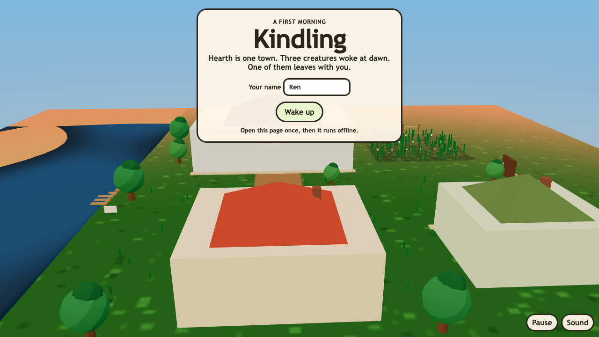

# Kindling

One town. Three creatures. A first morning.

**[Play the game](https://gabe-torres.github.io/kindling/)**



Kindling is a short pocket-monster morning. The shape of that morning comes from Pokémon Crystal: you wake up at home, a researcher has three starters, a rival is waiting, and the road out of town is shut. The town, the creatures, and the words are original. [Three.js](https://threejs.org/) draws Hearth. The sound is synthesized. [vite-plugin-pwa](https://vite-pwa-org.netlify.app/) caches the page so a home-screen install still runs offline. The published game is still one HTML file.

## How to play

You wake in Hearth. The morning is the whole game.

- Talk to Mom. She sends you to Professor Quill.
- On the benches: Pip (grass), Emberkit (fire), and Drop (water). Take one. They start at level 5.
- Vesper takes the kindling that beats yours and battles you in the lab. Tackle is the fair fight. The move that shares your partner's type is the one Vesper resists.
- Losing sends you home. The morning continues either way. Mom and the bed patch your partner.
- A win pays in rubies. Rubies are what Hearth spends. Pell, by the cove, sells a bun for 6 rubies, and it patches your partner.
- The meadow east of the lab has wild Mote, Peb, Sprig, and Wisp. Battles there raise your level.
- A partner changes at level 8 and again at level 12. Pip becomes Fernlet, then Mossantler. Emberkit becomes Coalpup, then Kilnhound. Drop becomes Brookit, then Rivercrest. Show Quill each change.
- The east road stays latched. Another town is a later page.

## Controls

On a phone:

- Drag the stick to walk. A talks, confirms, and picks a battle move.
- The buttons in the corner pause and mute.

On a computer:

- WASD or the arrow keys walk. North is up the screen.
- E, Space, or Enter talks and advances a line. Y and N answer a question.
- In battle, 1–4 pick a move. R runs from a wild battle.
- P pauses. M mutes.

The morning stays in this browser. Open the play link once while you are online, then add it to the home screen. The icon is a green sprout. After that the game runs with the network off.

## Develop

From this folder:

```bash
npm install
npm run dev
```

Open [http://localhost:5173/](http://localhost:5173/).

```bash
npm test          # checks the battle numbers and the camera frame
npm run build     # writes one HTML file and copies it to docs/
npm run preview   # serves that build
```

GitHub Pages serves `docs/index.html` at the play link above. The Vite entry stays `index.html`. Leave the source file alone when you publish.
